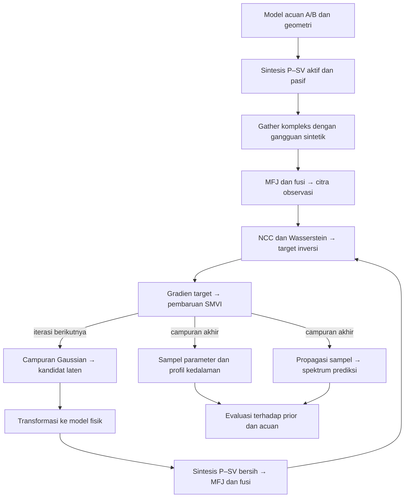

# Tutorial metodologi dan persamaan MFJ–SMVI v6

Panduan ini mengikuti eksperimen sintetik A dan B yang tersimpan di `results_v6/`. Tujuannya adalah memahami bagaimana parameter lapisan menghasilkan gelombang, bagaimana gelombang menjadi citra dispersi, dan bagaimana ketidakcocokan antar citra mengarahkan inversi. Gunakan [daftar persamaan dan keterangan simbol](PERSAMAAN_KODE.md) untuk detail setiap rumus dan [indeks fungsi](REFERENSI_FUNGSI.md) untuk menelusuri implementasinya.

## Peta perjalanan data



Sumbu yang paling sering muncul adalah frekuensi $`f`$ dalam Hz, offset $`r`$ dalam meter, kecepatan fase $`c`$ dalam m/s, dan bilangan gelombang horizontal $`k`$ dalam m⁻¹. Gather $`U(f,r)`$ menyimpan nilai kompleks pada posisi penerima. Citra $`D(f,c)`$ menyimpan intensitas ternormalisasi pada kecepatan fase yang dipindai. Sumbu $`c`$ pada citra dan parameter $`V_s`$ pada model mempunyai satuan yang sama dan mewakili besaran fisik yang berbeda.

## 1. Tentukan model acuan, parameter, dan geometri

**Masukan:** model bumi berlapis horizontal, batas parameter, lokasi tembakan dan stasiun. **Keluaran:** model acuan, domain model kandidat, serta offset dan frekuensi untuk sintesis.

Kedua benchmark memiliki tiga lapisan dengan tebal berhingga $`h_j`$ dan satu half-space. Vektor model $`m`$ menyimpan empat $`V_s`$, empat $`V_p`$, dan tiga $`h_j`$, dalam urutan tersebut. Densitas $`\rho`$ serta faktor kualitas $`Q_s,Q_p`$ diambil dari definisi masing-masing benchmark dan dipertahankan saat inversi.

```math
d_j=\sum_{i=1}^{j} h_i,\qquad
\mu_j=\rho_j V_{s,j}^2,\qquad
\lambda_j=\rho_j(V_{p,j}^2-2V_{s,j}^2).
```

$`d_j`$ adalah kedalaman antarmuka dari permukaan. $`\mu_j`$ dan $`\lambda_j`$ adalah parameter Lamé dalam pascal. Parameter mekanika ini menghubungkan kecepatan gelombang dengan respons elastik lapisan.

| Benchmark | Tebal lapisan berhingga (m) | Vs dari atas (m/s) | Vp dari atas (m/s) | Struktur yang dipelajari |
| --- | --- | --- | --- | --- |
| A | 4, 6, 14 | 260, 150, 390, 680 | 540, 480, 880, 1480 | Lapisan kecepatan rendah pada kedalaman 4–10 m |
| B | 3,5 / 6,5 / 14 | 175, 235, 350, 590 | 550, 1650, 1780, 1980 | Lonjakan Vp pada kedalaman 3,5 m |

Dari 48 penerima aktif dengan spasi 2 m dan enam posisi sumber di luar kedua ujung bentangan, kode menghasilkan 56 offset unik, 4–114 m. Kanal pasif memakai 25 stasiun nested. Jarak Euclidean setiap pasangan dihitung, pasangan dengan jarak lebih dari 1 m dipertahankan, dan jarak yang berimpit digabung. Artefak A/B memuat 293 offset pasif beserta koordinat stasiun. Jumlah pasangan dan azimut pada tiap offset ikut mengatur perturbasi pasif.

Untuk sampling reguler, $`k=2\pi f/c`$ dan $`k_{\mathrm{Nyq}}=\pi/\Delta x`$ memberi batas nominal $`c\ge 2f\Delta x`$. Pada 40 Hz dan spasi 2 m, batasnya 160 m/s. Memperhalus grid citra memberi lebih banyak kecepatan untuk dievaluasi. Batas sampling akuisisi tetap ditentukan posisi penerima.

Baca [definisi benchmark](../models.py#L241), [geometri aktif dan pasif](../forward_mfj.py#L125), dan [pemilihan grid](../run_benchmark.py#L261).

## 2. Hitung respons gelombang P–SV

**Masukan:** model berlapis, frekuensi, dan offset. **Keluaran:** fungsi Green vertikal $`G(\omega,r)`$ pada setiap pasangan frekuensi–offset, sebelum spektrum sumber dikalikan.

Pada setiap frekuensi sudut $`\omega=2\pi f`$, kode membentuk kecepatan kompleks dari faktor kualitas dan menambahkan pergeseran numerik $`\eta=0.005\omega`$. Bilangan gelombang vertikal kompleks $`\nu_\alpha`$ untuk P atau S menentukan propagasi dan peluruhan antarmuka.

```math
\widetilde V_\alpha=V_\alpha(1-i/(2Q_\alpha)),\qquad
\widetilde\omega=\omega+i\eta,\qquad
\nu_\alpha=\sqrt{k^2-\widetilde\omega^2/\widetilde V_\alpha^2}.
```

Untuk setiap $`(\omega,k)`$, matriks $`U_d,U_u`$ memuat basis perpindahan dengan arah turun dan naik. $`T_d,T_u`$ adalah matriks traksi yang bersesuaian. Hubungan traksi–perpindahan $`K_N=T_dU_d^{-1}`$ dimulai dari half-space yang memenuhi kondisi radiasi. Pada lapisan $`j`$, matriks refleksi $`R_j`$ diperoleh dengan mencocokkan kondisi pada antarmuka bawah. Faktor propagasi $`E_j`$ memindahkan informasi itu ke antarmuka atas.

```math
E_j=\mathrm{diag}(e^{-\nu_p h_j},e^{-\nu_s h_j}),\qquad
R_j=-(T_u-K_{j+1}U_u)^{-1}(T_d-K_{j+1}U_d),\qquad
X_j=E_jR_jE_j.
```

```math
K_j=(T_d+T_uX_j)(U_d+U_uX_j)^{-1},\qquad
G_{zz}(\omega,k)=-[K_1^{-1}]_{22}.
```

$`G_{zz}`$ adalah compliance vertikal permukaan dalam domain bilangan gelombang. Satu nilai respons untuk offset penerima diperoleh dengan mengintegrasikan banyak $`k_i`$ memakai fungsi Bessel $`J_0`$. Kode mengurangi kontribusi statik dari integran dan menambahkannya kembali secara analitik.

```math
G(\omega,r)\approx
\sum_i w_i[k_iG_{zz}(\omega,k_i)-A]J_0(k_i r)+\frac{A}{r},
\qquad A=\frac{1-\widetilde\nu_1}{\widetilde\mu_1}.
```

$`w_i`$ adalah bobot trapesium pada grid linier–logaritmik. Pada koefisien statik $`A`$, $`\widetilde\nu_1`$ menyatakan rasio Poisson kompleks lapisan pertama dan $`\widetilde\mu_1`$ modulus geser kompleksnya. Ini berbeda dari $`\nu_\alpha`$ di basis gelombang. Rekursi mengandung respons P–SV lengkap dalam model 1D, dengan atenuasi material melalui $`Q`$ dan kuadratur numerik hingga. Punggungan citra muncul dari respons yang disintesis. Kurva referensi Rayleigh dari `disba` hanya dipakai untuk pembandingan visual.

Baca [rekursi compliance](../forward_mfj.py#L329), [kuadratur dan fungsi Green](../forward_mfj.py#L803), serta [persamaan basis perpindahan dan traksi](PERSAMAAN_KODE.md#compliance-p-sv).

## 3. Bentuk gather aktif dan pasif

**Masukan:** fungsi Green, spektrum sumber per kanal, dan konfigurasi gangguan. **Keluaran:** `u_active` dan `u_passive` dengan bentuk frekuensi × offset.

```math
U_j(f,r)=S_j(f)G(2\pi f,r),\qquad
S_a(f)=x e^{-x},\quad x=(f/25\,\mathrm{Hz})^2,\qquad
S_p(f)=\frac{1}{1+(f/(6\,\mathrm{Hz}))^{1.5}}.
```

$`S_a`$ adalah bentuk spektral Ricker dan $`S_p`$ pembobotan frekuensi untuk proksi fungsi Green empiris pasif. Untuk observasi sintetik, kanal aktif diberi gain lognormal per offset dan fase acak. Kanal pasif diberi fase yang bergantung pada azimut dan offset. Keduanya mendapat noise kompleks yang berskala RMS per frekuensi. Skala noise pasif juga dibagi akar jumlah pasangan pada offset tersebut. Kandidat dalam inversi memakai jalur bersih.

Gambar gelombang waktu dihitung terpisah pada grid FFT. Konjugasi spektrum dan faktor $`e^{-i\omega t_0}`$ digunakan sebelum inverse real FFT, dengan $`t_0`$ sebagai pergeseran waktu sumber. Jejak dengan gangguan pada gambar memiliki realisasi tersendiri. Array frekuensi kompleks di `*_observations.npz` adalah masukan aktual pencitraan dan merupakan tempat yang tepat untuk menelusuri asal citra observasi.

Baca [sintesis gather dan jejak](../forward_mfj.py#L854) serta [urutan pemanggilannya](../run_benchmark.py#L98).

## 4. Ubah gather menjadi citra MFJ

**Masukan:** gather kompleks $`U(f,r)`$, offset dan bobot radial, grid kecepatan fase. **Keluaran:** `spec_active_raw` dan `spec_passive_raw` dengan bentuk frekuensi × kecepatan.

Pada frekuensi tetap, MFJ menguji apakah fase antar-offset koheren untuk kecepatan kandidat $`c`$. Untuk setiap offset $`r_m`$, argumen Hankel adalah $`x_m=\max(2\pi f r_m/c,10^{-4})`$. Kernel satu arah $`H_0^{(2)}=J_0-iY_0`$ mengikuti konvensi fase implementasi. $`J_0`$ dan $`Y_0`$ adalah fungsi Bessel orde nol jenis pertama dan kedua.

```math
\widehat U_m=\frac{U_m}{|U_m|+0.02\max_l|U_l|+10^{-30}},\qquad
I(f,c)=\left|\sum_m \widehat U_m\,T(r_m)\sqrt{r_m}\,\Delta r_m
\frac{H_0^{(2)}(x_m)}{|H_0^{(2)}(x_m)|+10^{-30}}\right|.
```

$`m,l`$ mengindeks offset pada baris frekuensi yang sama. Whitening $`\widehat U_m`$ mengurangi dominasi amplitudo jejak yang besar dan penstabil melindungi terhadap nilai sangat kecil. $`T(r_m)`$ mengecilkan kontribusi offset di tepi bentangan, $`\sqrt{r_m}`$ mengompensasi penyebaran silindris dalam pembobotan proyek, dan $`\Delta r_m`$ adalah bobot trapesium radial. Hasil proyeksi dibagi dengan maksimum pada frekuensi itu bila puncaknya cukup besar. Nilai tinggi menunjukkan koherensi pada kecepatan yang diuji. Atribusi punggungan pada moda tertentu memerlukan bukti tersendiri.

Integral Bessel pada tahap 2 menyintesis fungsi Green dari bilangan gelombang. Proyeksi Hankel pada tahap ini berjalan di ruang offset dan membentuk citra yang nanti dibandingkan oleh inversi. Komparasi geometri juga mengevaluasi kernel fase eksponensial dan $`J_0`$ dengan pra-pembobotan yang sama.

Baca [proyeksi MFJ](../forward_mfj.py#L616) dan [rumus lengkap serta rujukan Xi dkk.](PERSAMAAN_KODE.md#pencitraan-mfj).

## 5. Gabungkan kanal pada frekuensi native

**Masukan:** dua citra MFJ beserta grid frekuensinya. **Keluaran:** `d_fused`, citra tiap kanal pada grid gabungan, dan bobot `w_active` serta `w_passive`.

1. Pada setiap frekuensi, petakan intensitas kanal ke 0–1 dengan min–max, lalu pangkatkan dengan $`p=1.35`$. Irisan konstan menjadi nol.
2. Gunakan frekuensi pasif di bawah 8 Hz, node yang dihitung oleh kedua kanal di dalam 8–12 Hz, dan frekuensi aktif di atas 12 Hz. Pada 8 Hz bobot transisi sepenuhnya pasif dan pada 12 Hz sepenuhnya aktif. Grid gabungan yang tersimpan memiliki 45 node, 1–55 Hz. Sebelum fusi, array aktif memiliki 31 node dan array pasif 24 node, termasuk 0,5 Hz yang berada di bawah rentang gabungan.
3. Hitung bobot dari posisi dalam overlap dan bentuk kedua irisan, gabungkan, lalu lakukan min–max sekali lagi.

```math
s=\frac{f-8\,\mathrm{Hz}}{4\,\mathrm{Hz}},\qquad
\alpha=\sin^2(\pi s/2),\qquad
v_j=\max\!\left[\left(\frac{\mathrm{mean}_c D'_j}{\max_c D'_j+10^{-12}}\right)^2,10^{-4}\right].
```

```math
P_a=\frac{b_a\alpha}{v_a},\qquad P_p=\frac{b_p(1-\alpha)}{v_p},\qquad
w_j=\frac{P_j}{P_a+P_p+10^{-30}},\qquad
D=\mathrm{minmax}(w_aD'_a+w_pD'_p).
```

$`D'_j`$ adalah irisan yang sudah dinormalisasi, $`b_j`$ indikator tersedianya kanal, dan $`v_j`$ proksi empiris bentuk irisan. Saat hanya satu kanal tersedia, transisi disetel ke kanal tersebut. Pada 10 Hz, $`\alpha=0.5`$. Jika kedua kanal tersedia dan $`v_a=0.10,\ v_p=0.20`$, bobot akhir adalah sekitar 2/3 aktif dan 1/3 pasif. Proksi $`v_j`$ dihitung ulang untuk setiap model dan belum dikalibrasi sebagai ragam noise.

Baca [pemilihan node dan fusi](../fusion.py#L116) serta [keterangan simbol fusi](PERSAMAAN_KODE.md#fusi-frekuensi-native).

## 6. Ukur ketidakcocokan citra

**Masukan:** irisan observasi $`o`$ dan kandidat $`s`$ pada frekuensi dan grid kecepatan yang sama. **Keluaran:** skor misfit $`J`$, penalti NCC, dan ringkasan jarak Wasserstein dalam m/s. Seluruh irisan dipakai sesuai mask sehingga inversi berjalan tanpa picking kurva.

```math
\mathrm{NCC}(o,s)=\frac{o^\mathsf{T}s}{\max(\lVert o\rVert_2\lVert s\rVert_2,10^{-30})},
\qquad
p_i=\frac{\max(o_i,0)^2+10^{-12}}{\sum_l[\max(o_l,0)^2+10^{-12}]}.
```

$`1-\mathrm{NCC}`$ mengukur ketidakmiripan pola pada bin yang sama. Untuk transport, $`p_i`$ dan massa kandidat yang dibentuk dengan cara yang sama masing-masing berjumlah satu. $`\gamma_{ij}`$ adalah massa yang dipindahkan dari kecepatan $`c_i`$ ke $`c_j`$. Solver 1D memasangkan massa secara monoton dan memakai jarak dalam m/s.

```math
W_2^2=\sum_{ij}\gamma_{ij}(c_i-c_j)^2,\qquad
J=(1-\lambda)\overline{1-\mathrm{NCC}}+\lambda\,\frac{\overline{W_2^2}}{s_W^2}.
```

Jika seluruh massa observasi berada di 300 m/s dan seluruh massa sintetik di 340 m/s, pada contoh tanpa floor numerik jaraknya $`W_2=40\,\mathrm{m/s}`$. Dua puncak pada bin terpisah memberi NCC nol. Wasserstein memberi nilai yang ikut berubah sesuai besar perpindahan kedua puncak.

Garis atas adalah rerata berbobot trapesium pada frekuensi yang dipertahankan. Pada $`f\le12\,\mathrm{Hz}`$ kode membatasi citra ke $`c\le680\,\mathrm{m/s}`$ dengan minimal dua bin bila tersedia. Irisan yang kedua normanya nol dilewati secara numerik. Bobot $`\lambda=0.35`$ adalah bobot transport dalam misfit. Skala proyek $`s_W=0.15(c_{\max}-c_{\min})`$ ditentukan pada grid penuh sebelum mask, menghasilkan 169,2 m/s pada A dan 348 m/s pada B. Pembagian $`W_2^2/s_W^2`$ membuat kontribusi transport tanpa satuan.

Baca [transport dan misfit](../smvi_inversion.py#L30), [bobot frekuensi](../smvi_inversion.py#L233), serta [rumus dengan rujukan transport optimal](PERSAMAAN_KODE.md#transport-1d-dan-target-inversi).

## 7. Bentuk target inversi di ruang laten

**Masukan:** kandidat laten $`z`$, batas prior, dan misfit dari model fisik hasil transformasi. **Keluaran:** log target dan gradien yang dipakai SMVI.

Untuk koordinat $`i`$, batas bawah $`a_i`$ dan atas $`b_i`$ menentukan interval parameter fisik $`m_i`$. Sigmoid memetakan koordinat laten tak berbatas ke interval tersebut. $`V_s`$ dipetakan terlebih dahulu karena batas bawah $`V_p`$ memakai nilai maksimum antara batas nominal dan $`1.45V_s`$.

```math
s_i=\sigma(z_i)=\frac{1}{1+e^{-z_i}},\qquad
m_i=a_i+(b_i-a_i)s_i,\qquad
\log\widetilde\pi(z)=-\frac{J(m(z))}{2\sigma_D^2}+\log|\det Dm(z)|.
```

Untuk $`z=0`$, setiap sigmoid bernilai 0,5, sehingga diperoleh model tengah batas fisik dengan ketentuan batas bawah kondisional. Inilah pembanding titik yang dipakai laporan. $`Dm(z)`$ adalah Jacobian transformasi. Matriksnya triangular karena urutan pemetaan $`V_s`$ lalu $`V_p`$. Diagonalnya $`(b_i-a_i)s_i(1-s_i)`$, dan determinan adalah produk diagonal. Suku log-determinan mengoreksi perubahan volume dari prior yang seragam pada domain fisik.

$`\sigma_D=0.08`$ mengatur kekuatan penalti misfit. Target merupakan pembaruan berbasis loss. Skala tersebut belum diestimasi sebagai simpangan baku noise pengukuran. Pada run tersimpan, PyTorch menghitung gradien target yang melalui model fisik, sintesis bersih, pencitraan, fusi, dan misfit. Numba dipakai dalam evaluasi maju, dengan beda hingga sentral tersedia sebagai pembanding gradien.

Baca [transformasi laten](../models.py#L197), [log target dan pilihan gradien](../smvi_inversion.py#L281), dan [implementasi diferensiasi otomatis](../autodiff_likelihood.py#L163).

## 8. Optimalkan campuran Gaussian dengan SMVI

**Masukan:** target laten, pengaturan inisialisasi, dan anggaran optimasi. **Keluaran:** bobot dan parameter campuran akhir, riwayat optimasi, serta sampel parameter.

Pusat awal dipilih dari kandidat Latin hypercube yang dinilai dengan target. Opsi L-BFGS-B merapikan pusat awal. Setiap komponen dari campuran mempunyai mean laten $`\mu_k`$ dan matriks Cholesky segitiga bawah $`L_k`$ dengan diagonal positif, sehingga kovariansnya $`L_kL_k^\mathsf{T}`$. Bobot $`w_k`$ tetap sama selama optimasi.

```math
q(z)=\sum_{k=1}^{K}w_k\mathcal N(z;\mu_k,L_k L_k^\mathsf{T}),\qquad
w_k=1/K,\qquad
z_k=\mu_k+L_k\epsilon,\quad\epsilon\sim\mathcal N(0,I).
```

```math
\mathrm{ELBO}=\mathbb E_q[\log\widetilde\pi(z)-\log q(z)],\qquad
v(z)=\nabla_z\log\widetilde\pi(z)-\nabla_z\log q(z).
```

$`\mathbb E_q`$ adalah harapan di bawah campuran dan $`\nabla_z`$ adalah gradien terhadap parameter laten. Pada satu draw, $`v`$ mengarahkan mean dan $`v\epsilon^\mathsf{T}`$ memberi kontribusi gradien Cholesky. Gradien dirata-ratakan per komponen. Vektor $`\theta_j`$ berisi mean, log-diagonal, dan elemen di bawah diagonal Cholesky. Interaksi Stein memakai kernel Gaussian RBF $`\kappa`$ pada seluruh vektor parameter komponen.

```math
\Phi_i=\frac1K\sum_j
\left[\kappa(\theta_j,\theta_i)\,g_j+
\alpha_{\mathrm{S}}\nabla_{\theta_j}\kappa(\theta_j,\theta_i)\right].
```

$`g_j`$ adalah gradien pathwise komponen setelah dirata-ratakan. Suku pertama menyebarkan arah perbaikan antar komponen. Suku kedua mengatur repulsi dengan pengali proyek $`\alpha_{\mathrm{S}}=0.2`$. Adam melakukan ascent mengikuti $`\Phi_i`$. Satu iterasi berarti memperbarui seluruh komponen setelah sampel masing-masing dinilai.

| Pengaturan run tersimpan | Nilai |
| --- | --- |
| Seed A dan B | 2026 dan 2027 |
| Komponen dan iterasi | 4 komponen, 60 iterasi |
| Sampel gradien per komponen per iterasi | 4, dengan draw Gaussian yang sama antar komponen pada iterasi itu |
| Langkah maksimum refinement awal | 30 |
| Learning rate mean dan Cholesky | 0,04 dan 0,015 |
| Draw untuk ringkasan parameter | 1.200 |
| Anggaran draw prediksi | 128–512, seimbang per komponen |

Pembanding ensemble MCMC tersedia pada jalur ablasi. Stretch move mengusulkan langkah berdasarkan posisi walker lain dan menerima usulan memakai rasio target dengan koreksi dimensi. Autokorelasi dan ESS memeriksa efisiensi sampel. Mode `--benchmarks-only` pada run A/B yang tersimpan melewati pembandingan MCMC, ablasi, dan stress-test utama.

Baca [inisialisasi dan pembaruan SMVI](../smvi_inversion.py#L357), [persamaan Stein, Adam, dan MCMC](PERSAMAAN_KODE.md#campuran-gaussian-dan-optimasi-stein), serta [manifest eksperimen](../results_v6/run_manifest.json).

## 9. Propagasikan sampel ke profil dan prediksi

**Masukan:** campuran laten akhir dan operator maju bersih. **Keluaran:** sampel fisik, ringkasan parameter, profil kedalaman, dan citra prediksi.

| Keluaran | Cara memperoleh | Kunci penyimpanan |
| --- | --- | --- |
| Sampel parameter fisik | Ambil label komponen dan draw laten, lalu terapkan transformasi sigmoid | `posterior_samples_phys` |
| Spektrum model mean | Rata-ratakan parameter fisik terlebih dahulu, lalu jalankan forward sekali | `d_syn_posterior_mean` |
| Spektrum pusat terbaik | Pilih pusat komponen dengan $`J`$ terkecil di antara pusat yang diperiksa, lalu jalankan forward | `d_syn_best_component` |
| Spektrum prediksi rata-rata | Jalankan forward untuk banyak draw terstratifikasi per komponen, lalu rata-ratakan citranya | `d_posterior_predictive_mean` |

Jika $`D(m)`$ menyatakan seluruh operator ke citra fusi, prediksi rata-rata menaksir $`\mathbb E[D(m)]`$, sedangkan spektrum model mean menghitung $`D(\mathbb E[m])`$. Sintesis, MFJ, dan fusi bersifat nonlinier, sehingga kedua urutan ini umumnya menghasilkan gambar berbeda. Pusat terbaik adalah pilihan di antara pusat campuran.

```math
\overline D_k=\frac{1}{n}\sum_{i=1}^n D_{ki},\qquad
\widehat D=\sum_k w_k\overline D_k,\qquad
\widehat{\mathrm{Var}}_{\mathrm{MC}}(\widehat D)=
\sum_k w_k^2\,\frac{\widehat{\mathrm{Var}}(D_k)}{n}.
```

$`D_{ki}`$ adalah citra dari draw ke-$`i`$ pada komponen $`k`$. $`n`$ adalah jumlah draw per komponen. Simpangan baku respons menunjukkan sebaran citra akibat variasi parameter dalam campuran. Akar ragam MC di atas menunjukkan ketelitian rerata citra yang dihitung dari draw terbatas. Pemeriksaan presisi menggunakan galat baku bootstrap untuk $`J(\widehat D)`$, RMS galat baku citra, dan perubahan $`J`$ antara estimasi setengah dan seluruh draw. Toleransi run adalah 0,01 untuk dua galat baku dan 0,02 untuk perubahan misfit.

Untuk profil, setiap sampel membentuk antarmukanya sendiri. Pada setiap kedalaman, ambil $`V_s`$ atau $`V_p`$ dari lapisan yang memuat kedalaman tersebut. Rerata dan kuantil dihitung setelah evaluasi semua sampel pada grid kedalaman yang sama. Pita 95% memakai kuantil 2,5% dan 97,5% per kedalaman. Pita tersebut menggambarkan campuran yang dipasang dan kalibrasi cakupannya masih memerlukan evaluasi berulang.

Baca [prediksi dan bootstrap](../posterior_prediction.py#L11) dan [evaluasi profil kedalaman](../models.py#L318).

## 10. Baca hasil serta batas kesimpulannya

**Masukan:** observasi, spektrum model mean, prediksi, model tengah prior, model acuan, dan hasil kontrol independen. **Keluaran:** penilaian terpisah atas kecocokan citra, pemulihan parameter, dan ketelitian numerik.

| Run tersimpan | J tengah prior | J spektrum model mean | J prediksi rata-rata | J model acuan | Draw prediksi |
| --- | ---: | ---: | ---: | ---: | ---: |
| A | 0,36943 | 0,63742 | 0,29764 | 0,17391 | 256 |
| B | 0,38388 | 0,37867 | 0,46370 | 0,33542 | 512 |

- **A.** Rerata citra campuran memperbaiki misfit terhadap model tengah prior, sementara forward pada rerata parameter memberi misfit lebih besar. Ini contoh langsung pengaruh nonlinieritas operator.
- **B.** Spektrum model mean sedikit lebih cocok daripada tengah prior, sementara rerata spektrum campuran lebih buruk. Dekomposisi pada run ini melokalisasi kenaikan terbesar ke pita $`30<f\le42\,\mathrm{Hz}`$. Di antara tiga restart tambahan pada observasi yang sama, dua memperbaiki misfit prediksi terhadap prior dan satu lebih buruk. Hasil ini memperlihatkan sensitivitas terhadap fitting.
- **Model acuan.** Skor acuan dapat positif karena operator bersih dibandingkan dengan observasi yang mengandung gangguan. Kecocokan terhadap observasi dan pemulihan parameter fisik adalah dua pertanyaan yang perlu diperiksa. Untuk pemulihan profil $`V_s`$, laporan menghitung RMSE relatif dan MAPE terhadap profil acuan pada grid kedalaman.
- **Presisi.** A dan B memenuhi target Monte Carlo untuk campuran masing-masing. Restart, sensitivitas terhadap noise baru, dan kalibrasi kuantil adalah pemeriksaan lain dengan tujuan berbeda. Kedua run adalah eksperimen sintetik dengan operator internal yang sama untuk pembuatan observasi dan inversi.

Untuk menilai **forward**, PyProp8 digunakan sebagai pembanding independen pada titik compliance dalam domain frekuensi–bilangan gelombang. Pembandingan COMPOSTI pada kanal aktif A/B juga menguji gather dan citra MFJ. Pada konfigurasi bawaan, galat relatif L2 gather kompleks sekitar 6,4% untuk A dan 8,9% untuk B. Kontrol dengan pergeseran numerik $`\eta`$ dihilangkan pada grid bawaan, sambil mempertahankan redaman material, menurunkannya menjadi sekitar 0,51% dan 0,57%. Angka kontrol itu berasal dari eksperimen forward terpisah. Punggungan berkecepatan tinggi juga tampak pada citra COMPOSTI. Identitas moda serta kegunaannya untuk inversi Vp masih perlu ditetapkan.

Bandingkan [laporan A/B](../results_v6/DIAGNOSTIC_VERIFICATION_REPORT.md), [dekomposisi residual B](../diagnostics_review_v6/benchmark_b_residual/RINGKASAN.md), [restart dan noise baru](../diagnostics_review_v6/benchmark_b_restarts/RINGKASAN.md), [uji PyProp8](../results_v6_validation/independent_physics_validation.json), dan [kontrol COMPOSTI](../diagnostics_review_v6/benchmark_composti/RINGKASAN.md).

## Pseudocode untuk menelusuri satu run

```text
fungsi buat_citra(model, tambah_gangguan):
    untuk kanal aktif dan pasif:
        G ← hitung compliance P–SV dan integral Sommerfeld
        U ← kalikan G dengan spektrum sumber kanal
        jika tambah_gangguan, perturbasi U
        I[kanal] ← proyeksikan U ke grid kecepatan fase dengan MFJ
    kembalikan fusi citra I pada frekuensi native

untuk setiap benchmark:
    D_obs ← buat_citra(model_acuan, tambah_gangguan = ya)
    inisialisasi campuran q pada ruang laten
    ulangi sesuai anggaran iterasi:
        untuk draw z dari setiap komponen:
            m ← ubah z ke parameter fisik
            D_syn ← buat_citra(m, tambah_gangguan = tidak)
            J ← hitung misfit NCC dan Wasserstein dari D_obs dan D_syn
            hitung gradien log target dari J dan Jacobian
        perbarui campuran dengan gradien komponen, interaksi Stein, dan Adam
    evaluasi parameter dan profil dari sampel fisik campuran akhir
    rata-ratakan citra bersih dari draw seimbang per komponen
    simpan prediksi, presisi Monte Carlo, dan perbandingan terhadap prior serta acuan
```

## Latihan dari artefak tersimpan

Dari akar proyek, setelah lingkungan Python pada [README](../README.md) siap, jalankan potongan ini. Latihan membaca berkas hasil dan tidak melakukan inversi ulang.

```sh
.venv/bin/python - <<'PY'
import json
from pathlib import Path

import numpy as np

root = Path("results_v6")
report = json.loads((root / "benchmark_verification_summary.json").read_text())
for key in ("benchmark_a", "benchmark_b"):
    with np.load(root / f"{key}_observations.npz") as obs, \
         np.load(root / f"{key}_inference.npz") as fit:
        data = obs["d_fused"]
        model_mean = fit["d_syn_posterior_mean"]
        prediction = fit["d_posterior_predictive_mean"]
        assert data.shape == model_mean.shape == prediction.shape
        frequency_index = np.flatnonzero(np.isclose(obs["frequencies"], 10.0))[0]
        print(key, "gather:", obs["u_active"].shape, obs["u_passive"].shape)
        print("citra f-c:", data.shape)
        print("bobot aktif pada 10 Hz:", round(obs["w_active"][frequency_index], 4))
        print("selisih maksimum kedua jenis prediksi:",
              round(float(np.max(np.abs(prediction - model_mean))), 4))
    result = report[key]
    prior_misfit = result["baseline_comparison"]["prior_midpoint"]["misfit"]
    prediction_misfit = result["predictive_metrics"]["misfit"]
    print("perubahan J prediksi terhadap tengah prior:",
          round(prediction_misfit - prior_misfit, 5))
PY
```

Hasil yang diharapkan untuk citra fusi adalah 45 × 283 pada A dan 45 × 581 pada B. Bobot aktif pada 10 Hz sekitar 0,9769 pada A dan 0,8007 pada B. Perubahan misfit prediksi terhadap tengah prior sekitar −0,07180 untuk A dan +0,07982 untuk B. Setelah menjalankan latihan, buka gambar [spektrum B](../results_v6/benchmark_b_fig2_fc_spectrum_comparison.png) dan [profil B](../results_v6/benchmark_b_fig3_posterior_profiles_and_marginals.png). Coba jelaskan tiga hal dari hasil tersebut.

1. Mengapa `u_active` dan `d_fused` memiliki sumbu kedua yang berbeda? Gather disampel menurut offset penerima, sedangkan citra diproyeksikan pada grid kecepatan fase.
2. Mengapa bobot aktif pada 10 Hz bisa berbeda antara A dan B? Transisi pada frekuensi itu sama, tetapi proksi bentuk irisan dihitung dari citra masing-masing.
3. Mengapa $`J`$ prediksi bisa lebih buruk dari tengah prior walau anggaran MC mencukupi? Galat MC yang kecil mengukur presisi rerata dari campuran yang dipasang. Kecocokan campuran sendiri bergantung pada target dan hasil optimasi.

Untuk mengikuti kode, mulai dari [`run_single_benchmark`](../run_benchmark.py#L98). Ikuti satu kandidat melalui [`evaluate_physical_model`](../smvi_inversion.py#L281), lalu kembali ke [loop SMVI](../smvi_inversion.py#L453) dan akhiri di [prediksi campuran](../posterior_prediction.py#L11). Untuk menjalankan sintesis dan inversi baru, gunakan perintah pemeriksaan cepat di [README](../README.md#menjalankan) dengan folder keluaran baru.
